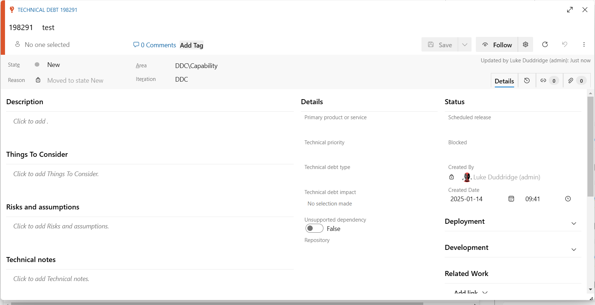

# How to Record and Refine Technical Debt

This how-to supports the [Technical Debt Policy](technical-debt.md), which remains the authoritative source for requirements.

## Record technical debt

1. Identify the product or team the debt relates to. If you cannot raise the item yourself, pass the information to the relevant team, product manager or service owner.
2. In the relevant area of Azure DevOps, create a `Technical debt` work item in the target project. Use the product or team location that applies to the debt.
3. Give the work item a concise title outlining the technical debt item.
4. Include the following minimum information in the description:
   * The repository where the debt lives. A repository link is useful, but its name is sufficient.
   * A detailed description of the issue, including class or file names where possible.
   * A proposed solution or ideas for a fix.
   * Cost, benefit and risk, including why it should be fixed and how long it might take.
5. Raise the item even if the debt will be resolved immediately. This helps show its impact and that it was discovered.

## Refine technical debt

1. Review whether the item meets the criteria in the [Technical Debt Policy](technical-debt.md). If it does not meet any of them, the source guidance says it should be considered debt with little or no value to resolution and considered for removal from the backlog.
2. If refinement identifies an imminent issue, such as old technical debt with high risk that is time-sensitive and has not been addressed, refine it and flag it to a senior Solution Architect, Product Manager and relevant Delivery Manager.

Accurately tracked technical debt work items support monitoring. See [Technical Debt Monitoring](../../software-engineering-policies/TechnicalDebt/TechnicalDebtMonitoring.md).
